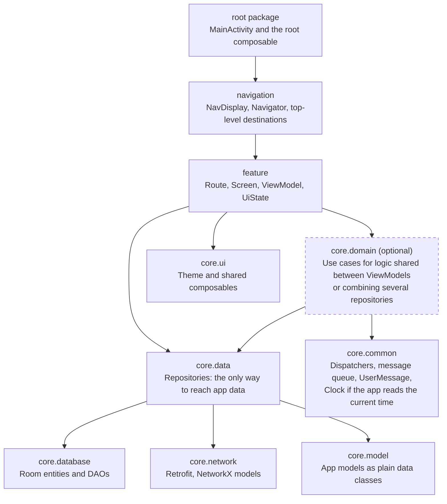

# Jetpack Compose App Architecture

Nov 4, 2026 · @Kim

## Architecture principles

The app is a single Gradle module (`app`) layered as displayed below under Layers and dependencies. Dependencies point one way, each layer keeps its own types to itself, and every screen is a stateful Route around a stateless Screen.

### Layers and dependencies



The diagram shows the main dependencies. The list below is the complete rule: anything not listed is forbidden.

- `core.model` → nothing. Plain data classes only.
- `core.common` → nothing. App-wide types and services: dispatcher qualifiers, the message queue, `UserMessage`, and `Clock` if the app reads the current time.
- `core.database`, `core.network` → nothing.
- `core.data` → `core.model`, `core.common`, `core.database`, `core.network`
- `core.domain` → `core.model`, `core.common`, `core.data`
- `core.ui` → `core.model`, `core.common`. No state, ViewModels or data access.
- `feature` → `core.model`, `core.common`, `core.data`, `core.domain`, `core.ui`. Never another feature.
- `navigation` → `feature`
- Root package (`MainActivity`, root composable) → `navigation`, `core.ui`, `core.common`

The generated `R` and `BuildConfig` classes are an exception: they end up in the root package because the app is one module, and every layer may import them.

Each layer has its own Hilt module in its own `di` package. Bind interfaces with `@Binds`.

The compiler doesn't enforce this in a single module, so check imports in every review.

### Data layer

Repositories are the only way to reach app data, and only app models leave the data layer.

- Each repository is an interface (`ItemRepository`) with a fake for tests and an implementation named after its source (`OfflineFirstItemRepository`, `RoomItemRepository`).
- Repository functions use app language (`addItem`, `observeItems`). Reads that change over time return `Flow` of app models. One-shot reads and writes are `suspend`.
- Each kind of data has an app model, plus one model for each source it comes from:
  - `Item` (plain data class) in `core.model`, always
  - `NetworkItem` (`@Serializable`) in `core.network.model`, if it comes from the network
  - `ItemEntity` (`@Entity`) in `core.database.entity`, if it is stored in Room
- Conversions (`NetworkItem.toItem()`, `ItemEntity.toItem()`, `Item.toEntity()`) are private extension functions in the repository implementation.
- With Room, stored data is read only from Room, its single source of truth. Data the app doesn't store, such as search results, may come straight from the network.
- Repositories let exceptions propagate. The ViewModel decides how to show them.
- An offline-first repository has a `suspend` refresh function (`refreshItems()`) that fetches from the network and writes to Room. The ViewModel calls it in `viewModelScope.launch` when the screen opens and on pull-to-refresh. If it fails, the stored data stays on screen and the error is transient.
- Inject dispatchers with a qualifier (`@IoDispatcher`). Never use `Dispatchers.*` directly.
- Room means Room 3 (`androidx.room3`), never Room 2 (`androidx.room`). It uses KSP and the `androidx.room3` Gradle plugin, and the database is built with `.setDriver(BundledSQLiteDriver())` from `androidx.sqlite:sqlite-bundled`.
- DAO functions are `suspend` or return `Flow`.
- Room schema changes use `AutoMigration` when possible and a manual `Migration` when needed, such as when data must be transformed. A manual `Migration` overrides `suspend fun migrate(connection: SQLiteConnection)`. Never use `fallbackToDestructiveMigration`.
- Room uses `exportSchema = true` and `room3 { schemaDirectory("$projectDir/schemas") }`, and the schema files are committed to Git.

### Domain layer (optional)

Add a use case only when logic is shared between ViewModels or combines several repositories; otherwise the ViewModel calls the repository directly.

- A use case is a class in `core.domain` with one `operator fun invoke`, created with `@Inject constructor`, for example `ObserveActiveItemsUseCase`.
- It depends only on repositories and app-wide services, and returns app models, usually as a `Flow`.

### ViewModels

- ViewModels are `@HiltViewModel` and depend only on repository interfaces, use cases and app-wide services (dispatchers, the message queue, `Clock` if used). A form's ViewModel also takes `SavedStateHandle`, see below.
- Content screens: UI state is one `StateFlow<XUiState>`, built from the repository's `Flow` with `stateIn(viewModelScope, SharingStarted.WhileSubscribed(5_000), XUiState.Loading)`. Never collect in `init` and copy into a `MutableStateFlow`.
- Forms: UI state, except text field input, is a private `MutableStateFlow(XUiState())`, exposed as `StateFlow`. An edit form loads its initial values with a one-shot `suspend` read, tracked with `isLoading`. If the read fails with an expected exception, the state holds a `loadError: UserMessage?`, shown as a blocking error with retry or back, and `retry()` runs the read again.
- One-time messages are a separate flow (see State and errors below).
- Screen input that the state depends on is merged with `combine` before `stateIn`. Text field input is `mutableStateOf` with a private setter. In forms it is created with the experimental `savedStateHandle.saveable { mutableStateOf("") }`, so that it survives process death. An edit form keeps a saved `hasLoadedInput` flag the same way and writes the loaded values to its text fields only while the flag is false, so they do not overwrite restored input. When the state depends on it, convert it with `snapshotFlow { query }` before `combine`. Other input (selected option, page number) is a private `MutableStateFlow`.
- Screen events are plain functions (`save()`, `delete(id)`). Writes run in `viewModelScope.launch`.
- Navigation arguments arrive as ids and other simple values through assisted injection, never as the destination or via `SavedStateHandle`, so tests can pass them directly.
- ViewModels never navigate. When navigation follows data work, the state says so and the Route navigates: a flag in a form's data class (`isSaved`), or a state of its own on a content screen (`XUiState.Deleted`), combined in before `stateIn` so it wins over the item disappearing from the `Flow`.

### UI: Route and Screen

Each `XScreen.kt` holds two composables, `XRoute` and `XScreen`.

- Route: gets its ViewModel with `hiltViewModel()`, or with `hiltViewModel<XViewModel, XViewModel.Factory> { it.create(id) }` when it has navigation arguments, and collects state with `collectAsStateWithLifecycle()`. It owns UI-only state, such as dialog visibility (`rememberSaveable`) and the `SnackbarHostState`, and reacts to navigation flags or states and to messages with `LaunchedEffect`.
- Screen: data comes in as parameters and events go out as lambdas. It never receives a ViewModel, the `Navigator` or a destination. It may `remember` only UI element state such as scroll position. Anything that decides what is shown, including whether a dialog is open, is a parameter. It places the `SnackbarHost` in its `Scaffold`, with the `SnackbarHostState` as a parameter.
- Lambdas describe what the user did, not where to go: `onOpenItem`, `onSaved`, `onBack`.
- Preview the Screen in every state (loading, error, empty, content, open dialogs), in light and dark mode.
- Composables stay in the feature that uses them. Only those shared by several features go in `core.ui.components`.
- User-facing strings live in one resource file per feature (`res/values/strings_profile.xml`). Strings shared by several features, and those used by `core.ui`, go in `strings_common.xml`.
- String names start with the feature (`profile_title`), or with `common_` in the shared file (`common_save`).
- Share a string only when the meaning is the same. The same word in different contexts gets separate strings, since translations may differ.
- English is the default language in `values/`, with translations in folders such as `values-sv/`. The project's own docs state which languages the app supports.

### Navigation

- Use Navigation 3 (`androidx.navigation3`). Destinations are `@Serializable` classes implementing `NavKey`, named `XDestination`. They carry only ids and other simple types (`String`, `Long`, `Int`, `Boolean`).
- Each feature has `<Name>Navigation.kt` in `feature.<name>.navigation`, holding its destinations and an entry builder `EntryProviderScope<NavKey>.xEntry(...)`. The entry builder calls `XRoute` with the destination's values and the screen's event lambdas.
- The app's `navigation` package holds `NavDisplay` and `Navigator`, plus `TopLevelDestination` if the app has tabs. Destinations are referenced only there and in their own feature's navigation file. Only `NavDisplay` connects one feature's lambdas to another feature's destinations.
- Only `Navigator` changes the back stack. It is the app's own class, not part of Navigation 3. Back stack rules, such as replacing the current screen, are `Navigator` functions, never list operations elsewhere. With tabs, it keeps one back stack per `TopLevelDestination`.
- `Navigator` is created in the `navigation` package around back stacks from `rememberNavBackStack`, and is not available through Hilt. The back stack therefore survives process death.
- Screens do not pass results back to each other. A screen saves through a repository, and the previous screen gets the change through its `Flow`.
- `NavDisplay` uses `rememberSaveableStateHolderNavEntryDecorator()` and `rememberViewModelStoreNavEntryDecorator()`, so each entry gets its own ViewModel.

### State and errors

- Screens that load content use a sealed `XUiState`: `Loading`, `Success`, `Error(message: UserMessage)`, plus any state that triggers navigation (`Deleted`). Empty is `Success` with an empty list. Forms use a data class with flags such as `isLoading` and `isSaving`.
- Derived values are getters, not stored fields. UiState never holds a `Throwable`, an exception message or user-facing text.
- Errors are either:
  - Blocking: content couldn't be loaded. Turn the flow's expected exceptions into `Error` with `.catch` before `stateIn`, and show it with retry or back.
  - Transient: an action failed while content is shown. Keep the content and show a snackbar through a one-time message.
- On content screens, retry restarts the content flow: build it inside `retryTrigger.flatMapLatest { … }`, with `.catch` and `onStart { emit(XUiState.Loading) }` inside, where `retryTrigger` is a private `MutableStateFlow<Int>` that `retry()` increments.
- Catch only expected exceptions (`IOException`, `HttpException`, `android.database.SQLException`). Never catch `Exception` or `Throwable`, and never wrap suspend calls in `runCatching`. These exception types are a deliberate exception to layers keeping their types to themselves: a ViewModel may import them, and nothing else from the libraries behind the data layer. On Android, Room 3 reports SQL errors as `android.database.SQLException`, also with the bundled driver. A `SerializationException` from unexpected JSON is a programming error and is not caught.
- One-time messages are a `UserMessage` enum in a separate `StateFlow<UserMessage?>`, backed by a private `MutableStateFlow`. The Route shows it and calls `onMessageShown()`. `core.ui` turns `UserMessage` into text.
- Messages that must outlive their screen, such as "not found" after leaving it, go through the app-wide message queue, shown by the root `SnackbarHost`.

### App-wide foundation

The `/new-project` skill creates this once, and features assume that it exists. The exception is `Clock`, which is added when first needed.

- Code that reads the current time injects `kotlin.time.Clock`, provided as `Clock.System` by a Hilt module in `core.common.di`.
- The dispatcher qualifiers, such as `@IoDispatcher`, are in `core.common`.
- The message queue is the interface `MessageQueue` in `core.common`, with `val messages: StateFlow<List<UserMessage>>`, `fun send(message: UserMessage)` and `fun onMessageShown()`. Its `@Singleton` implementation holds a private `MutableStateFlow`. `onMessageShown()` removes the first message, and `send` ignores a message equal to the last one, so the first message always changes after a removal. Never use a `Channel` or `SharedFlow` here, since they can lose messages.
- `AppViewModel` in the root package exposes `messages` and `onMessageShown()`, and only the root reads the queue. The root composable collects `messages` with `collectAsStateWithLifecycle()`. It shows the first message in the root `SnackbarHost` from a `LaunchedEffect` keyed on that message, and calls `onMessageShown()` when `showSnackbar` returns. A rotation may show a message twice, but never loses it.

### Example: content screen

This ViewModel shows how the rules above fit together: assisted navigation arguments, text field input, retry, a navigation state and a one-time message.

```kotlin
@HiltViewModel(assistedFactory = ItemDetailViewModel.Factory::class)
class ItemDetailViewModel @AssistedInject constructor(
    @Assisted private val itemId: Long,
    private val repository: ItemRepository,
) : ViewModel() {

    @AssistedFactory
    interface Factory {
        fun create(itemId: Long): ItemDetailViewModel
    }

    var query by mutableStateOf("")
        private set

    private val retryTrigger = MutableStateFlow(0)
    private val isDeleted = MutableStateFlow(false)

    private val _message = MutableStateFlow<UserMessage?>(null)
    val message: StateFlow<UserMessage?> = _message.asStateFlow()

    @OptIn(ExperimentalCoroutinesApi::class)
    val uiState: StateFlow<ItemDetailUiState> = combine(
        retryTrigger.flatMapLatest {
            combine(
                repository.observeItem(itemId),
                snapshotFlow { query },
            ) { item, query -> item.toUiState(query) }
                .onStart { emit(ItemDetailUiState.Loading) }
                .catch { e ->
                    when (e) {
                        is IOException, is HttpException, is SQLException ->
                            emit(ItemDetailUiState.Error(UserMessage.LOAD_FAILED))
                        else -> throw e
                    }
                }
        },
        isDeleted,
    ) { content, deleted ->
        if (deleted) ItemDetailUiState.Deleted else content
    }.stateIn(viewModelScope, SharingStarted.WhileSubscribed(5_000), ItemDetailUiState.Loading)

    fun onQueryChange(value: String) {
        query = value
    }

    fun retry() {
        retryTrigger.update { it + 1 }
    }

    fun delete() {
        viewModelScope.launch {
            try {
                repository.deleteItem(itemId)
                isDeleted.value = true
            } catch (e: IOException) {
                _message.value = UserMessage.DELETE_FAILED
            } catch (e: HttpException) {
                _message.value = UserMessage.DELETE_FAILED
            } catch (e: SQLException) {
                _message.value = UserMessage.DELETE_FAILED
            }
        }
    }

    fun onMessageShown() {
        _message.value = null
    }

    private fun Item?.toUiState(query: String): ItemDetailUiState =
        if (this == null) {
            ItemDetailUiState.Error(UserMessage.ITEM_NOT_FOUND)
        } else {
            ItemDetailUiState.Success(item = this, notes = notes.filter { it.contains(query, ignoreCase = true) })
        }
}
```
